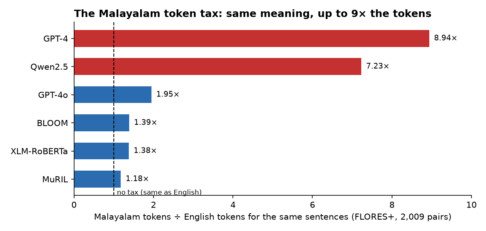
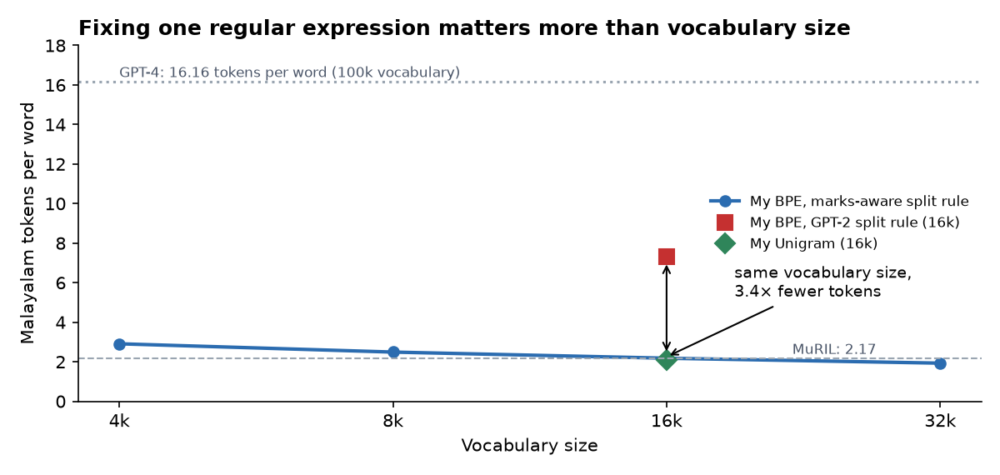
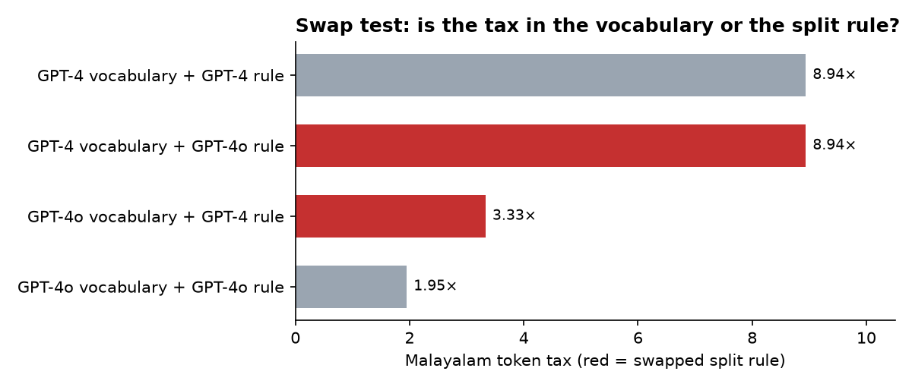
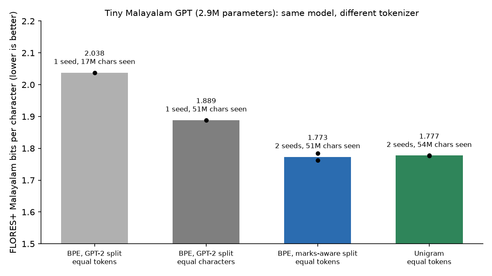

# The Malayalam Token Tax

**Measuring, explaining and fixing why LLM tokenizers charge Malayalam up to 9× more than English**


> **One six-word Malayalam sentence. GPT-4 needs 83 tokens. A tokenizer with a one-line fix needs 9.**

```
കേരളം ഇന്ത്യയുടെ തെക്കേ അറ്റത്തുള്ള ഒരു സംസ്ഥാനമാണ്.      "Kerala is a state at the southern tip of India."

GPT-4 (cl100k)            83 tokens
GPT-4o (o200k)            15 tokens
BPE, GPT-2 split rule     39 tokens   ക · േ · രള · ം · ഇന · ് · ത · ് · യയ · ു · ട · െ · ത · െ · ക · ് · ക · േ · അറ · ് · റത · ് · ...
BPE, marks-aware rule      9 tokens   കേരളം · ഇന്ത്യയുടെ · തെക്കേ · അറ്റ · ത്തുള്ള · ഒരു · സംസ്ഥാന · മാണ് · .
Unigram                    9 tokens   കേരള · ം · ഇന്ത്യയുടെ · തെക്കേ · അറ്റത്ത · ുള്ള · ഒരു · സംസ്ഥാന · മാണ്.
```

The GPT-2 split rule cuts every vowel sign (ു െ േ ാ) and every virama (്) off into a token of its own. One added `\p{M}` keeps the words whole.

## TL;DR

| | Result |
|---|---|
| 📏 **The tax** | Across 2,009 FLORES+ sentence pairs, Malayalam costs **8.94×** the English tokens on GPT-4, 7.23× on Qwen2.5, 1.95× on GPT-4o and just 1.18× on MuRIL. |
| 🔍 **A cause** | GPT-2-style split rules treat Malayalam vowel signs as word boundaries. Fixing the regex cuts tokens per word **3.4×** at the same vocabulary size (7.33 → 2.18). |
| 🔄 **Vocabulary or rule?** | A swap test shows that GPT-4's tax is **entirely its vocabulary**, while GPT-4o's improvement is about **⅔ vocabulary and ⅓ split rule**. |
| 🧠 **Does it matter for learning?** | With identical tiny GPTs, the broken split rule gives a **6.5% worse model even when trained on the same amount of text with 3× the compute**. Marks-aware BPE and Unigram tie. |

---

## 1. How big is the token tax?

**Data:** FLORES+ (dev + devtest), 2,009 sentences with the same meaning in English (`eng_Latn`) and Malayalam (`mal_Mlym`).
**Token tax** = Malayalam tokens ÷ English tokens for the same sentences (1.0 = no tax).



| Tokenizer | Token tax | Malayalam tokens per word |
|---|---|---|
| GPT-4 (`cl100k_base`) | **8.94×** | 16.16 |
| Qwen2.5 | 7.23× | 13.29 |
| GPT-4o (`o200k_base`) | 1.95× | 3.50 |
| BLOOM | 1.39× | 2.52 |
| XLM-RoBERTa | 1.38× | 2.80 |
| MuRIL | **1.18×** | 2.17 |

On GPT-4, a Malayalam user pays almost 9 times as much per sentence, and fits 9 times less text into the context window.

## 2. A cause: the split rule breaks words at vowel signs

Byte-level BPE tokenizers (GPT-2 style) first split text with a regular expression, then learn merges *inside* each piece. The GPT-2 rule keeps runs of letters (`\p{L}`) together. But Malayalam vowel signs and the virama (്) are Unicode **combining marks** (`\p{M}`), not letters. So every word is cut at every vowel sign before BPE starts, and no amount of training can merge across those cuts.

I trained my own tokenizers on Malayalam Wikipedia (19,065 articles, 60M characters) and changed only the split rule:

```python
FIXED_SPLIT = r" ?[\p{L}\p{M}]+| ?\p{N}+| ?[^\s\p{L}\p{M}\p{N}]+|\s+(?!\S)|\s+"
```



| My tokenizer (vocabulary size) | Tokens per word (FLORES+ Malayalam) |
|---|---|
| BPE, GPT-2 split rule (16k) | 7.33 |
| BPE, marks-aware split rule (4k) | 2.91 |
| BPE, marks-aware split rule (8k) | 2.49 |
| BPE, marks-aware split rule (16k) | **2.18** |
| BPE, marks-aware split rule (32k) | 1.93 |
| Unigram (16k) | 2.11 |

Even the **4k** marks-aware tokenizer beats the 16k GPT-2-rule one by 2.5×. The 16k version uses 7.4× fewer tokens than GPT-4 and matches MuRIL. All tokenizers decode every test sentence back to the exact original text.

## 3. Vocabulary or split rule? A swap test

GPT-4's split rule has no `\p{M}`; GPT-4o's does. So is GPT-4's tax caused by its split rule? I rebuilt both encodings with their split rules swapped (`tiktoken`, vocabularies unchanged):



| Vocabulary | Split rule | Malayalam tokens | Token tax |
|---|---|---|---|
| GPT-4 | GPT-4 | 473,735 | 8.94× |
| GPT-4 | **GPT-4o** | 473,735 | 8.94× (identical) |
| GPT-4o | GPT-4o | — | 1.95× |
| GPT-4o | **GPT-4** | 174,862 | 3.33× (+71%) |

- **GPT-4's tax is purely its vocabulary.** It has so few Malayalam merges that the split rule never matters.
- **GPT-4o's improvement** is about **two-thirds a better vocabulary and one-third a better split rule** (on a log scale).

My initial guess was that the split rule caused part of GPT-4's tax. This experiment showed it does not.

## 4. Does a better tokenizer give a better language model?

Fewer tokens is cheaper, but does it help a model *learn* Malayalam? I trained the same tiny GPT (2.9M parameters: 4 layers, width 128, 4 heads, 128-token context, 16k vocabulary) on Malayalam Wikipedia with each tokenizer. Everything was identical except the tokenizer.

**Metric:** bits per character (bpc) on FLORES+ Malayalam, which is never used for training. Unlike per-token loss, bpc is fair across tokenizers: it measures how well the model predicts the *text*, however the text is cut.



| Setting | Text seen in training | bpc (each seed) | Mean bpc |
|---|---|---|---|
| BPE, GPT-2 split, equal tokens (6,000 steps) | 17.0M chars | 2.038 | 2.038 |
| BPE, GPT-2 split, **equal characters** (18,100 steps) | 51.4M chars | 1.889 | 1.889 |
| BPE, marks-aware split (6,000 steps) | 51.5M chars | 1.784, 1.762 | **1.773** |
| Unigram (6,000 steps) | 53.7M chars | 1.776, 1.778 | **1.777** |

Lower is better.

**Findings**

- **The broken split rule makes a worse model.** With the same number of training tokens, the GPT-2-split model is 0.265 bpc worse. Part of that is just less data: its tokens carry only 1.39 characters each, so it saw 3× less text.
- **A control run separates the two.** Trained for 3× more steps, so it sees the same amount of *text*, the GPT-2-split model is still **0.116 bpc (about 6.5%) worse**, despite using 3× the compute. Roughly half the gap is less data, and half is the tokenizer itself.
- **Marks-aware BPE and Unigram are tied.** Their 0.004 bpc difference is far smaller than the 0.022 difference between two seeds of the same BPE model.

## Limitations

- **Tiny models.** 2.9M parameters and less than one pass over the training data. Effects may differ at large scale.
- **Two seeds at most.** Enough to show that BPE vs Unigram is a tie, not enough for confidence intervals. The equal-characters control has one seed.
- **Context length is not controlled.** Every model reads 128 tokens: about 180 characters for the GPT-2-split tokenizer but about 540 for the others. Some of the remaining 0.116 bpc gap may come from this.
- **One test set and one training domain** (FLORES+ and Wikipedia).
- **The tax is measured on translations,** so it reflects translation choices as well as tokenization.

## Reproduce

```bash
pip install torch tokenizers tiktoken transformers datasets numpy matplotlib truststore
python check_tokenizers.py      # quick look: one sentence, six tokenizers
python measure_tax.py           # token tax on FLORES+ (needs Hugging Face access to FLORES+)
python get_corpus.py            # Malayalam Wikipedia -> data/ml_wiki.txt
python train_tokenizers.py      # my BPE and Unigram tokenizers
python swap_rules.py            # vocabulary vs split-rule swap test
python train_lm.py --tok bpe_fixed_16k        # also bpe_gpt2split_16k, unigram_16k
python train_lm.py --tok bpe_gpt2split_16k --steps 18100 --tag bpe_gpt2split_16k_eqchars
python train_lm.py --tok bpe_fixed_16k --seed 1 --tag bpe_fixed_16k_seed1
python train_lm.py --tok unigram_16k --seed 1 --tag unigram_16k_seed1
python make_lm_chart.py         # results/lm_summary.csv and results/lm_bpc.png
python make_figures.py          # the other README figures and the example sentence
```

The trained tokenizers are in `tokenizers/` and ready to use:

```python
from tokenizers import Tokenizer
tok = Tokenizer.from_file("tokenizers/ml_bpe_fixed_16k.json")
print(tok.encode("കേരളം ഇന്ത്യയുടെ തെക്കേ അറ്റത്തുള്ള ഒരു സംസ്ഥാനമാണ്.").tokens)
```

Each language model trains in 30–90 minutes on a laptop CPU.

## Data and licences

- **FLORES+** (`openlanguagedata/flores_plus`, CC BY-SA 4.0) is used **only as a test set**, never for training. Its sentences are not included in this repository; only numbers derived from them are. The example sentence above is my own.
- **Malayalam Wikipedia** (`wikimedia/wikipedia`, `20231101.ml`, CC BY-SA 4.0) is used to train the tokenizers and models. The text itself is not included.

## Author

**Fathima Fiya K M** · M.Tech CSE, NIT Calicut
